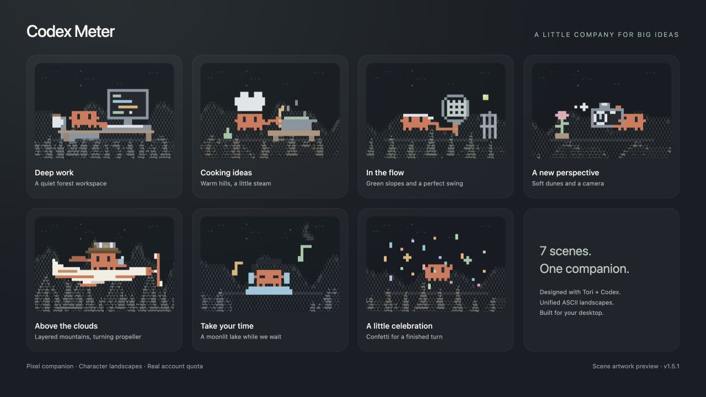
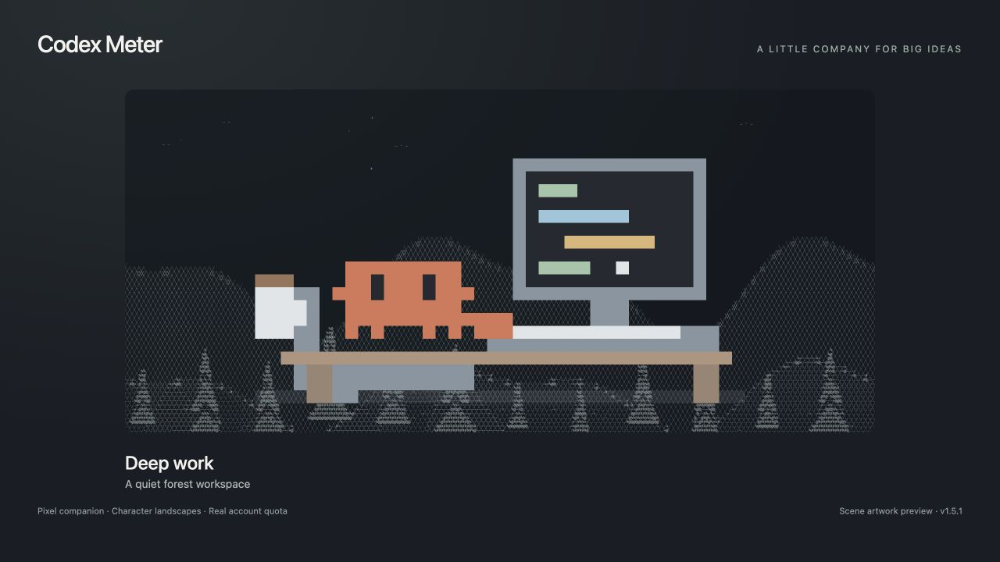
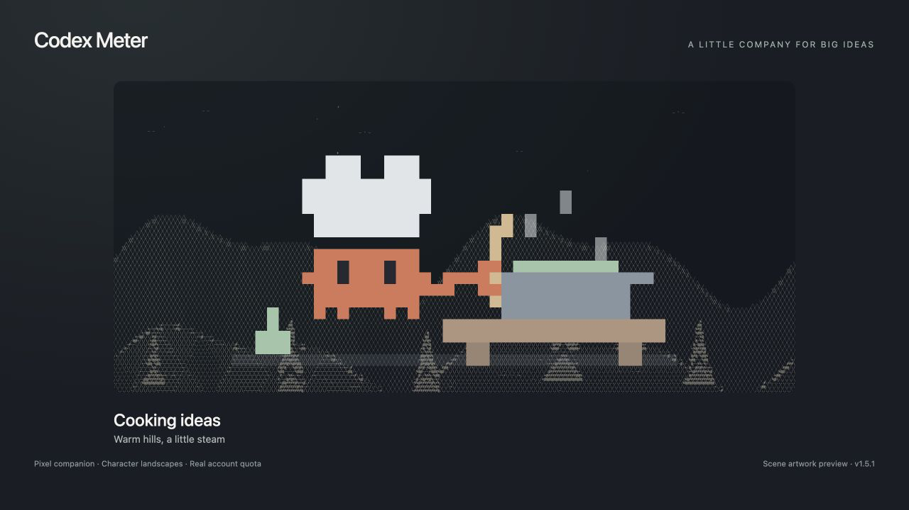
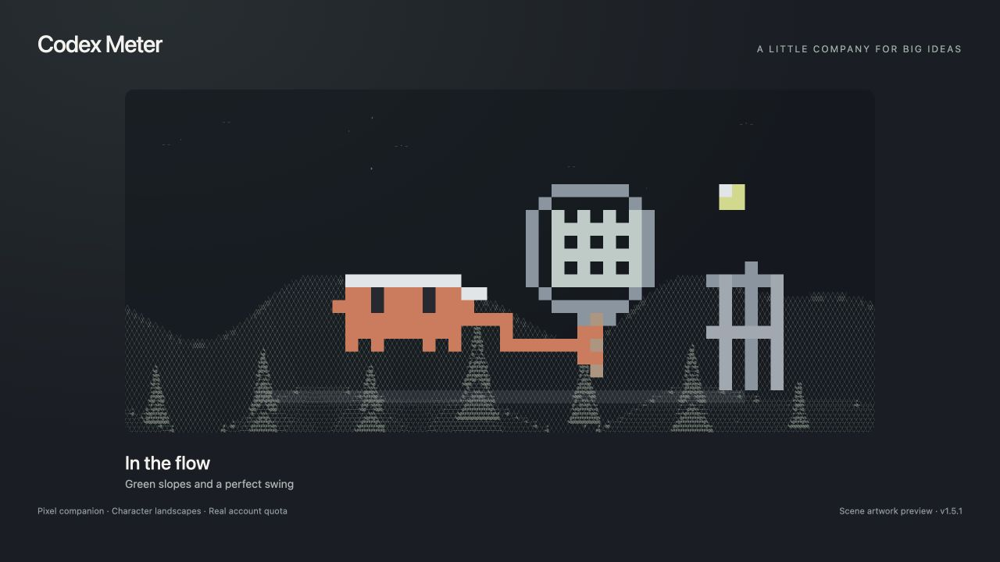
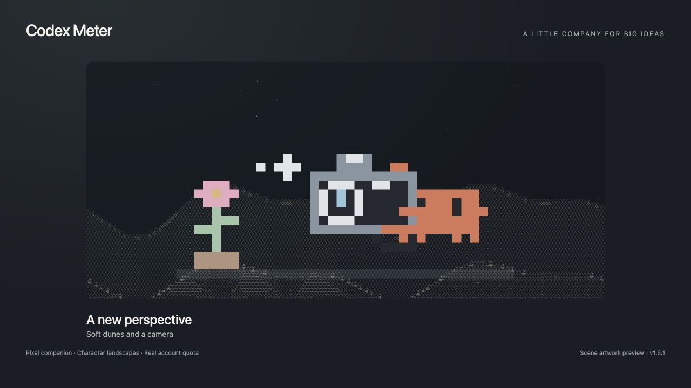
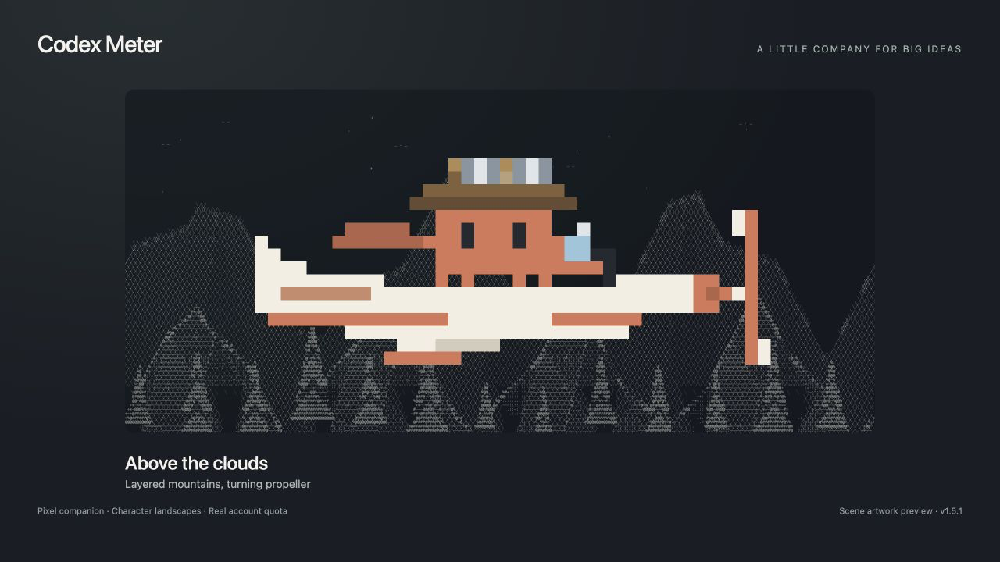
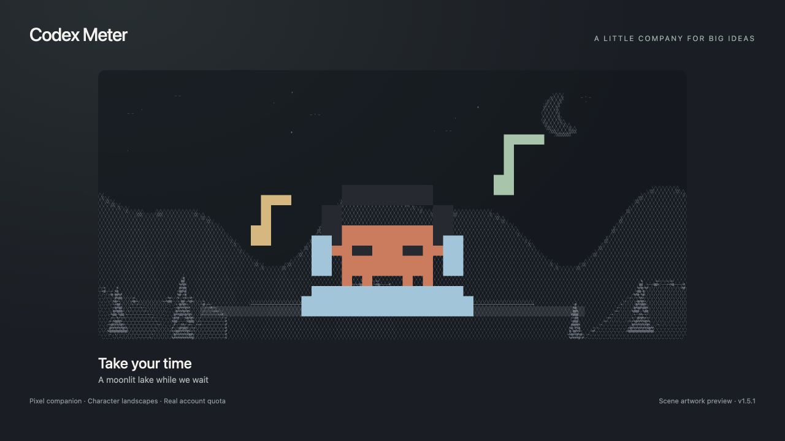
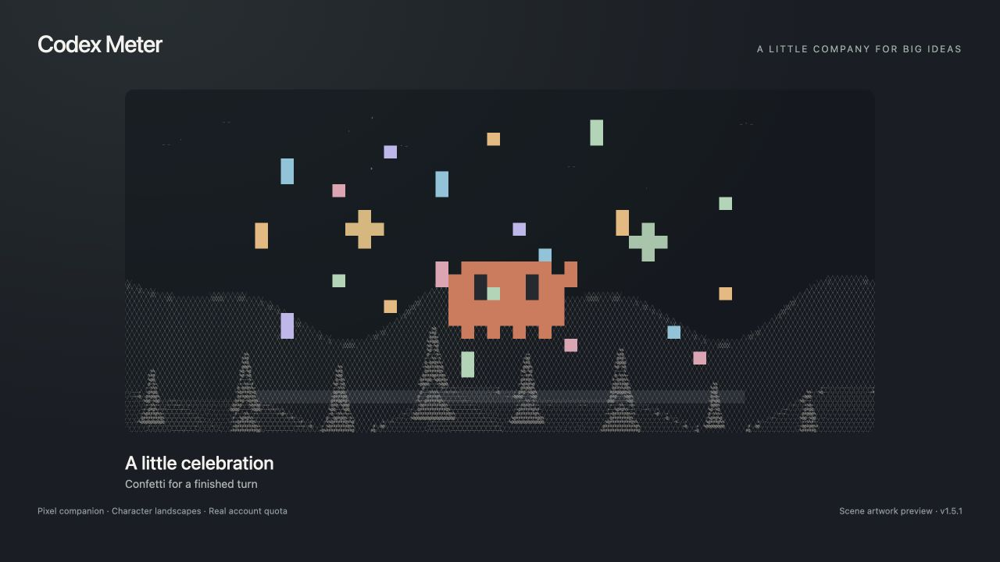

# Codex Meter 🦀

A little macOS desktop companion for Codex: see your remaining account quota, follow local tasks, and keep a pixel crab beside your work.

Built by [Tori Tao](https://toritao.com/#ai-apps) with Codex and Claude. Seven pixel scenes share a character-landscape style powered by [Tori Patterns](https://patterns.toritao.com/#/photo).

**Latest: Codex Meter v1.6.0 / build 14 · macOS 13+ · Apple Silicon.**

[Download Codex Meter](https://github.com/Toritao0723/codex-meter/raw/refs/heads/main/downloads/v1.6.0/Codex-Meter-macOS-arm64.zip) · [Installation and usage notes](src/README.md) · [Tori's portfolio](https://toritao.com/)

Looking for the Claude version? Visit [Claude Meter](https://github.com/Toritao0723/claude-meter).



## v1.6.0: sync repair + one shared floating companion

- Fixes stale quota after ChatGPT moved its bundled Codex CLI. Discovers both old and new application layouts on every refresh, retries lost connections, and refreshes after Mac wake.
- **Codex alone:** one compact companion, without a Claude slot.
- **Claude alone:** one compact companion, without a Codex slot.
- **Both meters running:** one floating window. Click **Codex ⇄ / Claude ⇄** beside the percentage to switch quota, tasks and animation together. The two quotas are never added together.
- Closing either meter leaves the other working; the visible window is handed over automatically. Both processes continue their own monitoring and notifications while sharing one window.
- Requires **Codex Meter 1.6.0+ and Claude Meter 1.7.0+** for shared-window mode. Older copies do not coordinate; update both. This does not install or launch the other meter automatically.

[Download v1.6.0](downloads/v1.6.0/Codex-Meter-macOS-arm64.zip) · [SHA-256](downloads/v1.6.0/SHA256SUMS.txt) · [Buildable source](src/) · [Claude 1.7.0](https://github.com/Toritao0723/claude-meter)

只开一个时没有第二款的空位；两款都打开时只保留一个浮窗，点额度旁的名称切换，数字与任务状态一起改变。退出一款后，另一款继续显示。请同时更新两个 Meter。

### Build the current version

```sh
git clone https://github.com/Toritao0723/codex-meter.git
cd codex-meter/src
python3 -m unittest test_bridge.py
zsh build.sh
```

The build is written to `/private/tmp/codex-meter-build/Codex Meter.app`. Quit the previous meter and copy the app to `~/Applications`. Settings are preserved. Node checks: `node --test test_*.cjs`. Coordination checks: `cat SharedCompanion.swift test_companion.swift > /tmp/meter-coordination-test.swift && swift /tmp/meter-coordination-test.swift`.

Shared coordination is local to your Mac account under `~/Library/Application Support/Tori Meter/companion-v1/`: private files hold current quota/task display snapshots and two limited commands (refresh/open task). No credentials or conversation messages are copied. A process lock permits one visible window; missing or stale peers are removed from the switcher.

### Earlier downloads

## Codex Meter v1.5.2 — download / restore

- [macOS Apple Silicon app](Codex-Meter-v1.5.2-macOS-arm64.zip) — the installed app snapshot.
- [Complete source, app and artwork backup](Codex-Meter-v1.5.2-complete-backup.zip) — original folder structure, build scripts, tests, source credits and all previews.
- [Git history bundle](Codex-Meter-v1.5.2-backup.bundle) — all local commits, branches and the `v1.5.2` tag; source commit `de97283f2f120a075fd085eeb87eb64ba035ebe1`.
- [Version manifest](v1.5.2-manifest.json) · [SHA-256 checksums](SHA256SUMS-v1.5.2.txt) · [Full usage notes](SOURCE-README-v1.5.2.md).

The historical archive and bundle have separate histories. Current buildable source now lives in `src/`; the archives below are retained for rollback.

### Existing Mac installation

Quit Codex Meter, unzip the app archive, and place `Codex Meter.app` in `~/Applications/`. Open it after signing in to the official Codex app on that Mac. macOS 13+, Apple Silicon and Apple Command Line Tools / Python 3 are required. The app uses local ad-hoc signing and is not Apple-notarized; new machines may need to build it locally. Intel is not verified.

### Build from source

Unzip the complete backup and enter `Codex-Meter-v1.5.2`. Install Apple Command Line Tools if needed, then run:

```sh
xcode-select --install  # only if Command Line Tools are not already installed
python3 -m unittest -v test_bridge.py
./build.sh
mkdir -p "$HOME/Applications"
ditto --norsrc --noextattr "/private/tmp/codex-meter-build/Codex Meter.app" "$HOME/Applications/Codex Meter.app"
open "$HOME/Applications/Codex Meter.app"
```

JavaScript checks, if Node.js is installed: `node --test test_task_nav.cjs test_pet.cjs test_language.cjs`.

Restore the Git repository using:

```sh
git clone Codex-Meter-v1.5.2-backup.bundle codex-meter-source
cd codex-meter-source
git checkout v1.5.2
```

## New in v1.5.2

White `codex` identity in all sizes, aligned compact-panel labels, improved artwork spacing, and a persistent Chinese / English panel toggle beside Refresh in the full panel. Native menus and notifications remain Chinese. The scene artwork previews below were created for v1.5.1 and remain unchanged.

Previous v1.5.1 archives and checksums are retained.

## Seven matching scenes

| Deep work | Cooking ideas | In the flow |
|---|---|---|
|  |  |  |

| A new perspective | Above the clouds | Take your time |
|---|---|---|
|  |  |  |

[](scene-done.png)

All eight PNGs are 1280 × 720. They contain artwork only, with no personal task titles or account usage. [Video outline and Chinese / English X post drafts](LAUNCH-DRAFT.md) are ready for the next editing session.

## What the Codex version does today

- Reads real Codex account quota windows and reset times; quota percentage is not an API balance or a remaining-token count.
- Shows one selected task at a time, with arrows for navigation and reply-needed prompts.
- Five working activities, music while waiting, confetti when a turn finishes.
- Full, compact and pet-only modes; native macOS glass with light / dark appearance.
- Reads local state and the official read-only quota endpoint. Monitoring and cached scenery do not call a model.

Completion means the current response turn ended, not that the whole project is finished. Permission approval popups cannot all be detected reliably. Only recent, unarchived tasks with local logs on this Mac are covered. The Codex app monitors Codex; the separate [Claude app has its own public repository](https://github.com/Toritao0723/claude-meter).

## Credits and earlier backup

Based on [Bon Yeung’s Claude-Meter](https://github.com/bonyuiux/Claude-Meter). Original UI and pixel character © 2026 Bon Yeung; original documentation and attribution remain in [UPSTREAM.md](UPSTREAM.md) and source comments. Character landscapes adapt [Tori Patterns Photo Lab](https://patterns.toritao.com/#/photo), with visual inspiration from [Claude FM](https://www.youtube.com/watch?v=tRsQsTMvPNg). Unofficial, not an OpenAI or Anthropic product.

The [v1.3.0 complete backup](Codex-Meter-v1.3.0-complete-backup.zip), [app](Codex-Meter-v1.3.0-macOS-arm64.zip) and [bundle](Codex-Meter-v1.3.0-backup.bundle) remain available. Backups exclude API keys, login credentials, task logs, usage caches and personal app preferences.
